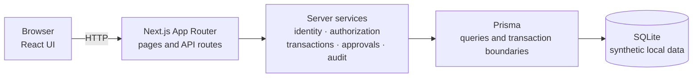

# Architecture

> This prototype evaluates whether Devin can accelerate the development of one representative fintech internal workflow. It reproduces selected application-level capabilities but does not recreate Retool’s managed platform or operational capabilities.

## System

| Layer | Responsibility |
|---|---|
| Browser | Displays queues, details, decision controls, pending approvals, and recent audit events; sends identity and workflow requests. |
| Next.js | Serves the UI and API routes, applies mutation-request checks, and returns stable HTTP responses. |
| Server services | Load the current user, enforce role policies, validate input, apply transaction and maker-checker rules, and create audit events. |
| Prisma | Provides typed database access, conditional updates, unique-constraint handling, and atomic transaction boundaries. |
| SQLite | Stores deterministic synthetic users, customers, transactions, approval requests, and audit events for the local prototype. |

## Identity and authorization

The browser selects one of three seeded identities. The server validates the
unsigned user ID from an HttpOnly cookie and reloads the persisted user and role
for every protected request. Client-supplied roles, actors, states, reviewers,
and approval targets are not trusted. This is a demonstration boundary, not
authentication; anyone with application access can select any seeded identity.

Server policies allow all three roles to view transactions, only Operations to
make decisions or create high-value requests, and only Approvers to view and
complete pending approvals or view recent audit events.

## Workflow and integrity

- A `FLAGGED` transaction can become `APPROVED`, `REJECTED`, or `ESCALATED`;
  those states are terminal in this prototype.
- Approve and Reject at or below `100000` minor units are direct Operations
  decisions. Above that threshold they create a `PENDING` approval request and
  leave the transaction `FLAGGED`.
- A checker can approve the server-derived target or veto the request. The
  requester is excluded by persisted user ID, and a transaction has at most one
  active request.
- Direct updates and their audit events commit in one Prisma transaction.
  Request creation and its `PENDING` audit event are also atomic. Completion
  atomically changes the request, clears active ownership, conditionally applies
  the transaction state, and records the final audit event.
- Conditional `updateMany` operations provide compare-and-set behavior for
  stale or concurrent writes. SQLite serializes local writes, so the tested
  exactly-one completion behavior is not a distributed concurrency guarantee.

## Data and production boundaries

Money is stored as integer minor units. Seed data is synthetic and USD-only;
only account last-four values are stored and returned as masked references.
Audit actor snapshots preserve who the server recognized when an event was
created, but the local audit store is resettable and directly mutable.

A production system would require real authentication and session management,
finer-grained authorization, managed policy configuration, a production
database and concurrency design, deployment and observability, rate limiting,
durable audit retention/export, incident response, integrations, and formal
security and compliance validation.
